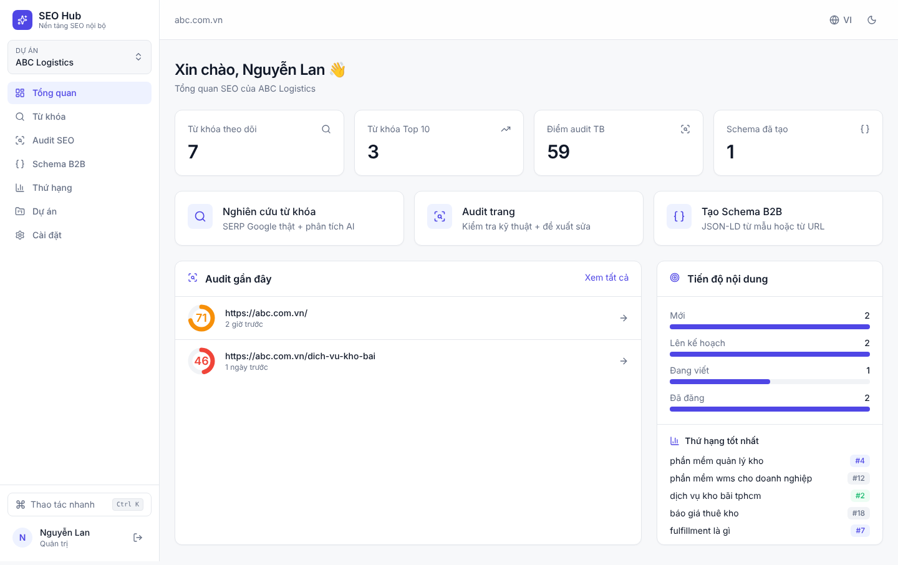
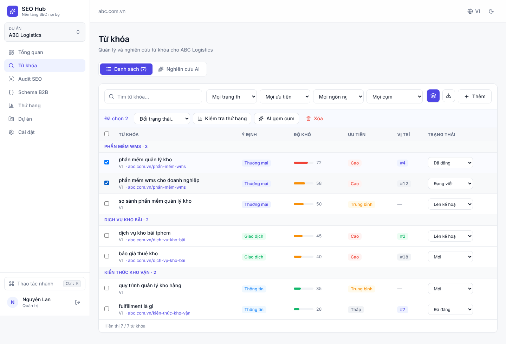
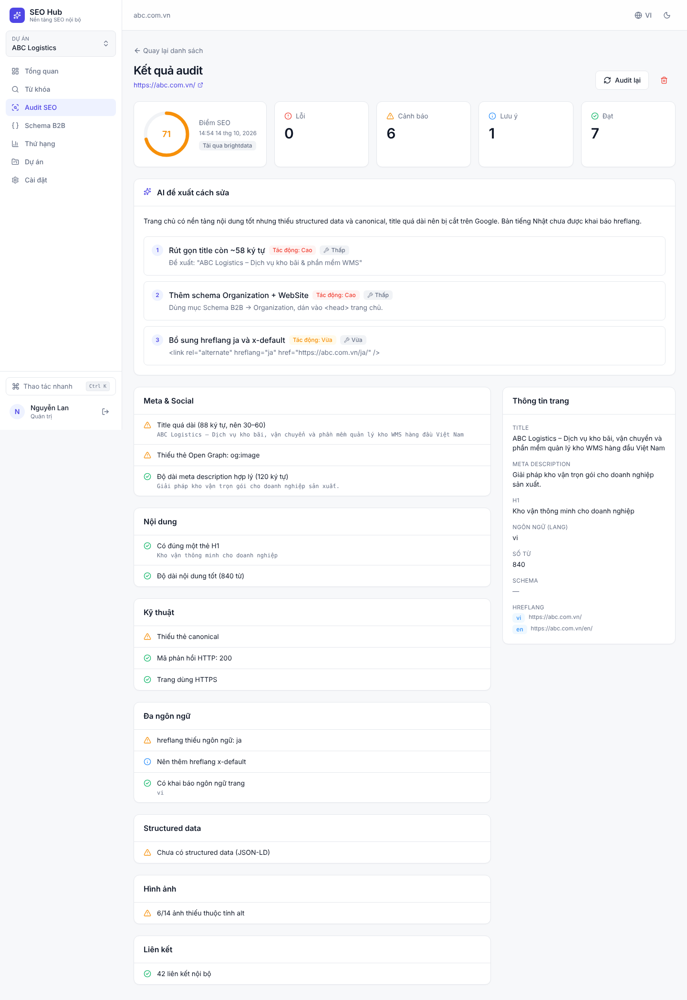
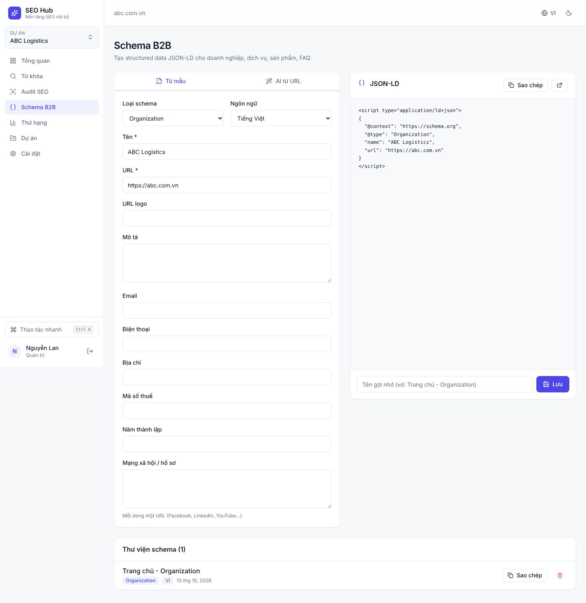
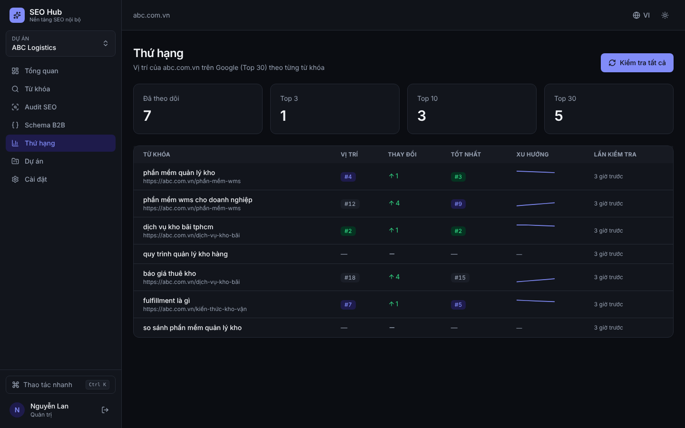
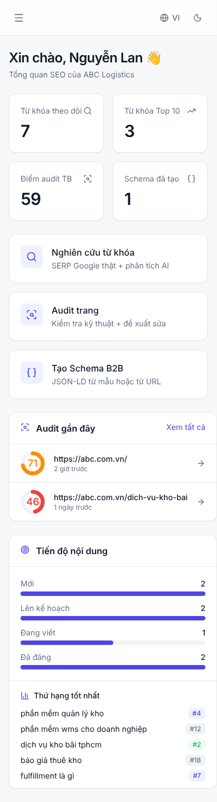

# SEO Hub — Nền tảng SEO nội bộ cho doanh nghiệp

Ứng dụng web nội bộ giúp nhân viên marketing nghiên cứu từ khóa, audit SEO, tạo Schema B2B và theo dõi thứ hạng Google cho nhiều website, nhiều ngôn ngữ.

**Stack:** Next.js 15 (App Router) · Supabase (Postgres + Auth + RLS) · Bright Data (SERP API + Web Unlocker) · Claude API · Tailwind CSS v4 · next-intl

## Chức năng

| Module | Mô tả |
|---|---|
| **Tổng quan** | Số liệu chính, thao tác nhanh, audit gần đây, tiến độ nội dung, thứ hạng tốt nhất |
| **Từ khóa → Nghiên cứu AI** | Lấy Top 10 Google thật (Bright Data SERP) theo ngôn ngữ/quốc gia → Claude đề xuất 15–25 từ khóa B2B, ý định tìm kiếm, độ khó ước tính, cụm chủ đề, khoảng trống nội dung, đối thủ |
| **Từ khóa → Danh sách** | Lọc, nhóm theo cụm, đổi trạng thái (Mới → Lên kế hoạch → Đang viết → Đã đăng), thao tác hàng loạt, AI gom cụm, xuất CSV, thêm thủ công |
| **Audit SEO** | Tải trang qua Web Unlocker → kiểm tra meta, heading, nội dung, canonical, indexability, Open Graph, ảnh alt, liên kết, JSON-LD, `lang`, **hreflang theo ngôn ngữ của dự án** → chấm điểm → Claude đề xuất cách sửa theo thứ tự ưu tiên |
| **Schema B2B** | Form mẫu (Organization, LocalBusiness, Service, Product, FAQPage, BreadcrumbList, Article) với xem trước trực tiếp, hoặc **AI tạo JSON-LD từ URL**; thư viện schema, sao chép 1 chạm |
| **Thứ hạng** | Kiểm tra vị trí domain trong Top 30 Google **theo từng quốc gia** (proxy đặt tại nước đó), lịch sử, thay đổi, biểu đồ xu hướng |
| **Dự án** | Nhiều website; mỗi dự án có ngôn ngữ chính, ~40 ngôn ngữ nội dung và **nhiều thị trường quốc tế** (toàn bộ quốc gia Google hỗ trợ) |
| **Cài đặt** | Hồ sơ, trạng thái tích hợp, phân quyền nhân viên (Quản trị / Biên tập / Chỉ xem) |

Tối ưu cho nhân viên: giao diện tiếng Việt/English, chế độ sáng/tối, `Ctrl + K` mở thao tác nhanh, chọn dự án một lần cho mọi trang, thao tác hàng loạt, xuất CSV, responsive trên mobile.

## Cài đặt

### 1. Supabase
1. Tạo project trên [supabase.com](https://supabase.com).
2. Chạy migration **theo thứ tự**: dán lần lượt `0001_init.sql` → `0002_international_and_profiles.sql` → `0003_grants.sql` (trong `supabase/migrations/`) vào **SQL Editor**, hoặc `supabase db push` nếu dùng Supabase CLI.
3. **Authentication → Providers → Email**: bật Email. Với hệ thống nội bộ nên **tắt "Allow new users to sign up"** và mời nhân viên qua **Authentication → Users → Invite**.
4. **Authentication → URL Configuration**: thêm `https://<domain-app>/auth/callback` vào Redirect URLs.
5. Người đăng nhập đầu tiên tự động là **Quản trị**; những người sau là **Biên tập**, admin đổi quyền trong *Cài đặt*.

### 2. Bright Data
Trong [Bright Data dashboard](https://brightdata.com/cp) cần 2 zone: **SERP API** và **Web Unlocker** (mặc định `serp_api1`, `web_unlocker1`, được tạo khi dùng MCP). Lấy API token ở *Account settings*.

### 3. Claude API
Tạo API key tại [console.anthropic.com](https://console.anthropic.com). Mặc định dùng model `claude-opus-5-5`, có thể đổi bằng `ANTHROPIC_MODEL`.

### 4. Chạy ứng dụng
```bash
cp .env.example .env.local   # điền các giá trị
npm install
npm run dev                  # http://localhost:3000
```

Triển khai: Vercel (khuyến nghị) — đặt các biến môi trường như `.env.example`. Các tác vụ AI/SERP có thể mất 20–60 giây; các trang liên quan đã đặt `maxDuration = 300` (cần gói Vercel hỗ trợ thời gian chạy dài).

## Dành cho developer (Claude Code)
- `.mcp.json` khai báo **Bright Data MCP**, token đọc từ biến môi trường `BRIGHTDATA_API_TOKEN`.
- Plugin **SearchFIT SEO** và **Bright Data** được bật qua tài khoản claude.ai; dùng các skill như `/searchfit-seo:seo-audit`, `/searchfit-seo:schema-markup` khi phát triển.

## Cấu trúc
```
src/
  app/(app)/          trang sau đăng nhập (dashboard, keywords, audits, schemas, rankings, projects, settings)
  app/actions/        server actions (gọi Supabase, Bright Data, Claude)
  lib/brightdata.ts   SERP API, Web Unlocker, kiểm tra thứ hạng
  lib/ai.ts           Claude: phân tích từ khóa, gom cụm, nhận định audit, sinh schema (structured outputs)
  lib/audit.ts        parse HTML + bộ quy tắc audit + chấm điểm
  lib/schema-templates.ts  mẫu JSON-LD B2B
messages/             bản dịch giao diện (vi, en)
supabase/migrations/  schema DB + Row Level Security
```

## Lưu ý
- Tài khoản tạo **trước** khi chạy migration sẽ được tự tạo profile ở lần đăng nhập kế tiếp (migration 0002). Nếu hệ thống chưa có admin, tài khoản đó thành admin.
- **Độ khó từ khóa là ước tính của AI** dựa trên đối thủ trên SERP; Bright Data không cung cấp search volume. Nếu cần volume chính xác, có thể tích hợp thêm Google Ads Keyword Planner / Search Console.
- Kiểm tra thứ hạng tốn 1–3 request SERP mỗi từ khóa (Top 30), chạy theo lô 25 từ khóa.

## Ảnh giao diện (dữ liệu minh họa)
| | |
|---|---|
|  |  |
|  |  |
|  |  |
